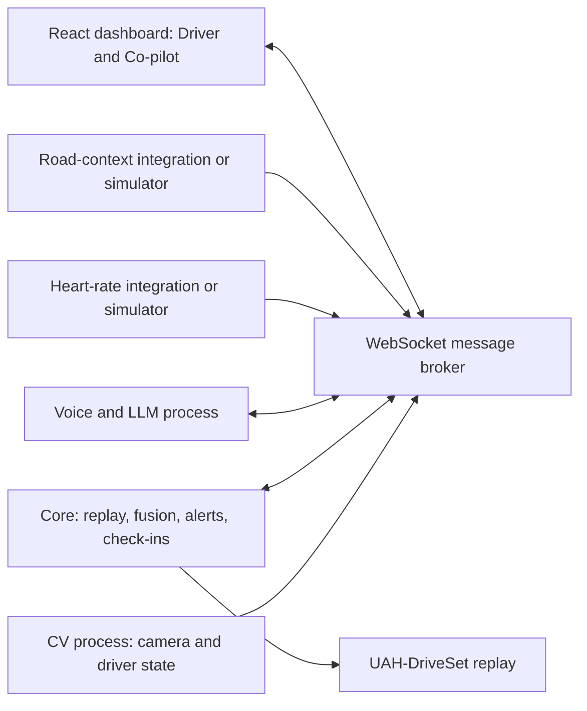

# DriveMate

DriveMate is a driver-safety copilot prototype built for the CodeLap 2026 hackathon. It combines live driver signals, vehicle replay, voice interaction, and a passenger-facing dashboard. The Driver view is designed for a quick glance; the Co-pilot view shows live signals and demo controls.

## Architecture



Processes exchange typed messages through the broker at `ws://localhost:8765/bus`. Topic definitions are in `backend/schemas.py`, generated contract data is in `docs/contract.json`, and dashboard TypeScript types are in `dashboard/src/types.ts`. Thresholds and the demo profile are in `config/thresholds.yaml`.

## Requirements

- Python 3.11 (see `requirements.txt`)
- Node.js and npm
- For live CV/voice modes, the matching camera, audio devices, model files, and Python packages
- Internet access for first-time package/model setup; demo fallback modes are available for several processes

## Install and run

From the repository root:

```bash
python3.11 -m venv .venv
.venv/bin/python -m pip install -r requirements.txt
cd dashboard
npm install
cd ..
```

Start all services with simulated inputs in one terminal:

```bash
DRIVEMATE_PROFILE=demo bash scripts/run_all.sh --fake
```

Start the dashboard in a second terminal:

```bash
cd dashboard
npm run dev
```

Open the local URL printed by Vite. To run processes with their available live sources, omit `--fake`; individual services and their simulator options are documented in their module help. Stop the services with `Ctrl+C` in the `run_all.sh` terminal.

The dashboard uses `ws://localhost:8765/bus` by default. To change it, set `VITE_BUS_URL` in `dashboard/.env.local`. Never put server-side secrets in a `VITE_` variable; browser-visible variables are public. Copy `.env.example` for optional server integrations and keep populated `.env` files out of Git.

## Dashboard

- `/driver`: driver status, current spoken message, check-in timer, and pre-trip setup.
- `/copilot`: camera preview, driver gauges, conversation, event timeline, attention cues, heart rate, road context, cabin audio, acceleration, replay controls, and trip summary.
- `/debug`: broker topic log with recent payloads and message rates.

The camera preview is held in memory and is not saved by the dashboard. The charts use a bounded 60-second history.

## Vehicle data and licensing

Vehicle replay uses UAH-DriveSet v1. It is a non-commercial dataset; cite E. Romera, L. M. Bergasa, and R. Arroyo, “Need Data for Driving Behavior Analysis? Presenting the Public UAH-DriveSet,” IEEE ITSC 2016, pp. 387–392. Do not redistribute the dataset or modified copies. Download and extraction notes, data columns, and route selections are in [`docs/datasets.md`](docs/datasets.md). Local datasets are stored under `data/` and excluded from Git.

CV training data and its access terms are inventoried in [`training/DATASETS.md`](training/DATASETS.md). Review each dataset’s current terms before downloading or using it. Training data and camera recordings are not committed. The team’s media assets are under `assets/`; verify each track’s usage rights before public distribution.

## Model metrics and limits

The checked-in training report is [`models/trained/training_report.json`](models/trained/training_report.json). These are dataset validation metrics, not a claim of person-independent or in-vehicle accuracy:

| Model | Reported split | Macro F1 | Accuracy |
| --- | --- | ---: | ---: |
| Emotion (anger / other) | Provided test folder | 0.550 | 0.778 |
| Drowsiness | Chronological holdout within recordings | 0.533 | Not reported |
| Distraction | Chronological holdout within recordings | 0.517 | Not reported |
| Age (3 classes) | Stratified image holdout | 0.782 | 0.819 |

The DMD recordings may share drivers between train and validation; age data has no subject IDs. These metrics therefore do not meet a held-out-person evaluation standard. See the training report and [`training/DATASETS.md`](training/DATASETS.md) for split details. Do not interpret the prototype’s scores as medical advice or as a replacement for safe driving decisions.

## Integrations and demo limits

- Heart rate is simulated (`python -m backend.integrations.hr.run`, scenarios with `--scenario`) or replayed from a Suunto .FIT file (`--fit PATH`). There is no live Bluetooth mode: it was removed because it did not work reliably on every laptop. Present heart rate in the demo as simulated.
- Road context can run in simulator mode. A real traffic/places API integration is optional and requires a restricted key and billing review.
- The crash demo shows the emergency contact and location in the dashboard when external calling credentials are unavailable. Do not treat the demo as a real emergency service.
- The trivia demo button in Replay & Demo Controls is intentionally marked pending: the current shared `control.inject` contract supports only harsh-brake and crash events. Core must add and approve a trigger before the UI can publish it.

## Development checks

```bash
cd dashboard && npm run build
cd ..
.venv/bin/python scripts/smoke_test.py
```

Python unit tests can be run with:

```bash
.venv/bin/python -m unittest discover -s tests -v
```

## Tools and acknowledgements

The team used React, Vite, TypeScript, Python, OpenCV/MediaPipe, PyTorch, FastAPI, and WebSockets. AI coding assistants (including OpenAI Codex and Claude Code) were used during development; team members reviewed and integrated the resulting changes. See the individual dataset records for source citations and licensing notes.
