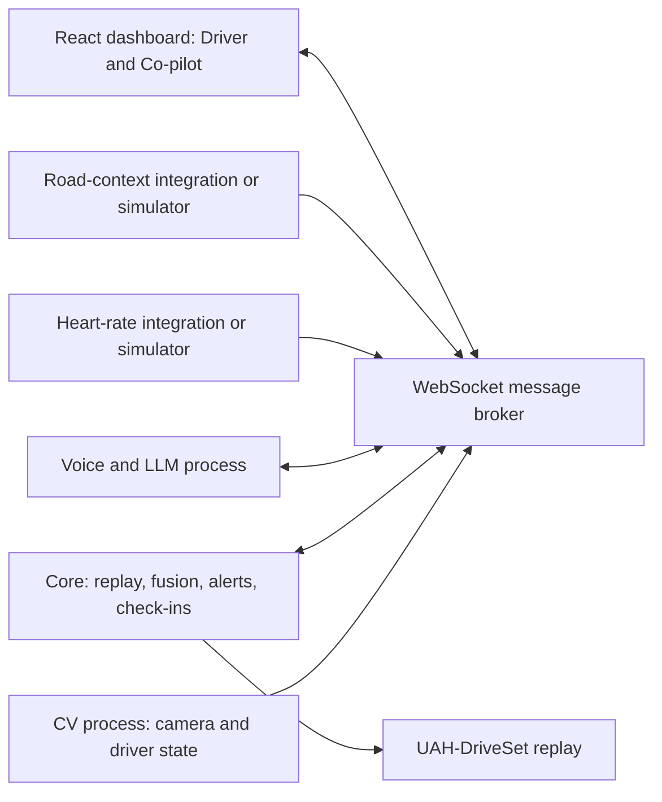

# DriveMate

DriveMate is a driver-safety copilot prototype built for the CodeLap 2026 hackathon. It combines live driver signals, vehicle replay, voice interaction, and a passenger-facing dashboard. The Driver view is designed for a quick glance; the Co-pilot view shows live signals and demo controls.

## Architecture



Processes exchange typed messages through the broker at `ws://localhost:8765/bus`. Topic definitions are in `backend/schemas.py`, generated contract data is in `docs/contract.json`, and dashboard TypeScript types are in `dashboard/src/types.ts`. Thresholds and the demo profile are in `config/thresholds.yaml`.

## Requirements

| What | Version / notes |
| --- | --- |
| Python | **3.11** (macOS: `brew install python@3.11`) |
| Node.js | **20** with npm (macOS: `brew install node@20`; it is keg-only, so add `export PATH="/opt/homebrew/opt/node@20/bin:$PATH"` to your shell) |
| Webcam | built-in laptop camera by default (camera index 0) |
| Microphone | any; the driver answers every alert by voice |
| Internet | needed once for installing and the first model downloads; the demo then runs offline (LLM lines fall back to templates, speech to the system voice) |

On macOS, allow **Camera** and **Microphone** for your terminal app (System Settings > Privacy & Security) the first time it asks.

## Install (once)

From the repository root:

```bash
# 1. Python packages
python3.11 -m venv .venv
.venv/bin/python -m pip install --upgrade pip
.venv/bin/python -m pip install -r requirements.txt

# 2. Dashboard packages
cd dashboard && npm install && cd ..

# 3. Face-landmark model for the camera (not in Git, about 4 MB)
bash data/download_datasets.sh mediapipe

# 4. Secrets: optional LLM key (without one, alerts and trivia use templates and the offline question bank)
cp .env.example .env        # then set GROQ_API_KEY
```

Already in the repository: the trained CV models (`models/trained/*.pt`, `models/eye_state.onnx`), the pre-recorded voice clips and the demo music. The speech-to-text model (Whisper `base`) downloads by itself on the first voice run.

Optional, for real vehicle data: download **UAH-DriveSet v1** into `data/UAH-DRIVESET-v1/` as described in [`docs/datasets.md`](docs/datasets.md) (a licence form, so it cannot be scripted). Without it, core publishes a synthetic motorway drive and everything else works the same.

## Run

Two terminals, from the repository root:

```bash
# Terminal 1: broker, core, camera, voice, heart rate (simulated), road context (simulated)
DRIVEMATE_PROFILE=demo scripts/run_all.sh

# Terminal 2: dashboard
cd dashboard && npm run dev
```

Open <http://localhost:5173>. `Ctrl+C` in each terminal stops everything. `run_all.sh` restarts any process that exits, so a camera or microphone that appears later is picked up on its own.

- `DRIVEMATE_PROFILE=demo` shortens time windows for the 5-minute demo; leave it out for real-trip timings.
- **The car starts parked** (0 km/h) so the pre-trip form can be filled in; **Start trip** starts the motorway replay.
- Demo buttons in the replay panel: **Harsh brake**, **Simulate crash**, **Zone out (trivia)**.

Other ways to run:

```bash
scripts/run_all.sh --fake            # everything on synthetic data: no camera, microphone or LLM needed
scripts/run_all.sh --fake=cv,voice   # only these on synthetic data, the rest live
python -m backend.cv.run --camera 1  # one process alone, here CV on a USB webcam
```

To use a USB webcam with `run_all.sh`, set `cv.camera.index: 1` in `config/thresholds.yaml` (with a USB camera plugged in, macOS may swap the numbers; try 0 and 1).

### Check that it works

```bash
.venv/bin/python scripts/smoke_test.py   # with the app running: every topic arrives at its rate
.venv/bin/python -m pytest -q            # unit tests
```

### Troubleshooting

| Symptom | Fix |
| --- | --- |
| `Unable to open webcam index 0` in the `[cv]` log | Allow camera access for the terminal, close other apps using the camera, or change `cv.camera.index` |
| Voice never hears you | Allow microphone access for the terminal, then restart `run_all.sh` |
| `address already in use` on 8765 or 5173 | An older run is still going: stop it, or `pkill -f "m backend\."` |
| `npm: command not found` | Node 20 is keg-only: add it to `PATH` (see Requirements) |
| Alerts sound generic | No LLM key or no internet: templates are used by design; set `GROQ_API_KEY` in `.env` |

The dashboard uses `ws://localhost:8765/bus` by default. To change it, set `VITE_BUS_URL` in `dashboard/.env.local`. Never put server-side secrets in a `VITE_` variable; browser-visible variables are public.

## Dashboard

- `/driver`: driver status, current spoken message, check-in timer, and pre-trip setup.
- `/copilot`: camera preview, driver gauges, conversation, event timeline, attention cues, heart rate, road context, cabin audio, acceleration, replay controls, and trip summary.
- `/debug`: broker topic log with recent payloads and message rates.

The camera preview is held in memory and is not saved by the dashboard. The charts use a bounded 60-second history.

## Vehicle data and licensing

Vehicle replay uses UAH-DriveSet v1. It is a non-commercial dataset; cite E. Romera, L. M. Bergasa, and R. Arroyo, “Need Data for Driving Behavior Analysis? Presenting the Public UAH-DriveSet,” IEEE ITSC 2016, pp. 387–392. Do not redistribute the dataset or modified copies. Download and extraction notes, data columns, and route selections are in [`docs/datasets.md`](docs/datasets.md). Local datasets are stored under `data/` and excluded from Git.

CV training data and its access terms are inventoried in [`training/DATASETS.md`](training/DATASETS.md). Review each dataset’s current terms before downloading or using it. Training data and camera recordings are not committed. The team’s media assets are under `assets/`; verify each track’s usage rights before public distribution.

## Model metrics and limits

The checked-in training report is [`models/trained/training_report.json`](models/trained/training_report.json). These are dataset validation metrics, not a claim of person-independent or in-vehicle accuracy:

| Model | Reported split | Macro F1 | Accuracy |
| --- | --- | ---: | ---: |
| Emotion (anger / other) | Provided test folder | 0.550 | 0.778 |
| Drowsiness | Chronological holdout within recordings | 0.533 | Not reported |
| Distraction | Chronological holdout within recordings | 0.517 | Not reported |
| Age (3 classes) | Stratified image holdout | 0.782 | 0.819 |

The DMD recordings may share drivers between train and validation; age data has no subject IDs. These metrics therefore do not meet a held-out-person evaluation standard. See the training report and [`training/DATASETS.md`](training/DATASETS.md) for split details. Do not interpret the prototype’s scores as medical advice or as a replacement for safe driving decisions.

## Integrations and demo limits

- Heart rate is simulated (`python -m backend.integrations.hr.run`, scenarios with `--scenario`) or replayed from a Suunto .FIT file (`--fit PATH`). There is no live Bluetooth mode: it was removed because it did not work reliably on every laptop. Present heart rate in the demo as simulated.
- Road context can run in simulator mode. A real traffic/places API integration is optional and requires a restricted key and billing review.
- The crash demo shows the emergency contact and location in the dashboard when external calling credentials are unavailable. Do not treat the demo as a real emergency service.
- The trivia demo button in Replay & Demo Controls is intentionally marked pending: the current shared `control.inject` contract supports only harsh-brake and crash events. Core must add and approve a trigger before the UI can publish it.

## Development checks

```bash
cd dashboard && npm run build
cd ..
.venv/bin/python scripts/smoke_test.py
```

Python unit tests can be run with:

```bash
.venv/bin/python -m unittest discover -s tests -v
```

## Tools and acknowledgements

The team used React, Vite, TypeScript, Python, OpenCV/MediaPipe, PyTorch, FastAPI, and WebSockets. AI coding assistants (including OpenAI Codex and Claude Code) were used during development; team members reviewed and integrated the resulting changes. See the individual dataset records for source citations and licensing notes.
